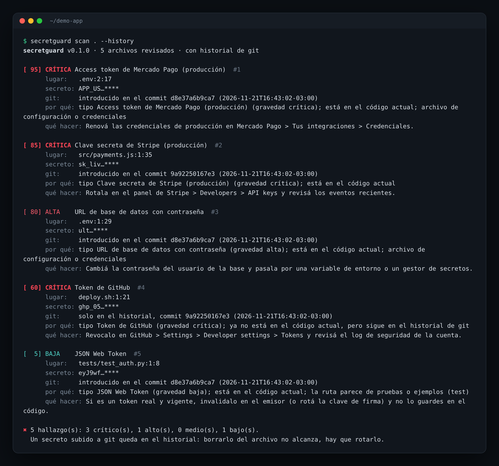

# secretguard

**Encuentra secretos en tu código y en tu historial de git, ordenados por riesgo real y con los pasos para revocarlos.**

[](https://github.com/ulisespignatelli/secretguard/actions/workflows/ci.yml)




Claves de AWS, tokens de GitHub, credenciales de Mercado Pago o Stripe, URLs de bases de datos con contraseña,
claves privadas: un secreto subido a un repositorio es una de las formas más comunes de comprometer una
organización. Y borrarlo del archivo no alcanza, porque queda en el historial de git.

secretguard los encuentra antes que otros, y responde las tres preguntas que importan:

1. **¿Qué tan grave es?** Cada hallazgo tiene un puntaje de 0 a 100 que combina el tipo de secreto con su
   contexto: ¿está en el código actual o solo en el historial? ¿En un `.env` o en una carpeta de tests?
2. **¿Por qué?** El puntaje viene explicado, para que decidas rápido.
3. **¿Qué hago?** Cada tipo de secreto trae los pasos para revocarlo en su proveedor.

## Qué lo diferencia

| | |
|---|---|
| **Cero dependencias** | Solo la biblioteca estándar de Go. Una herramienta de seguridad no debería sumar cadena de suministro que atacar. |
| **Riesgo, no solo coincidencias** | Ordena por puntaje: lo crítico y vigente primero, el JWT de prueba al final. |
| **Nunca muestra el secreto** | Ni en la terminal ni en los informes: solo los primeros caracteres y una huella. |
| **Historial completo** | Revisa todas las ramas y te dice en qué commit entró cada secreto, o si ya solo vive en el historial. |
| **Directo desde GitHub** | Un repo, todos los de un usuario o los de una organización, con enlace a cada línea. |
| **Proveedores de la región** | Mercado Pago, además de AWS, GitHub, GitLab, Stripe, Google, Slack, OpenAI, Anthropic y más. |
| **Listo para CI** | SARIF para la pestaña *Security* de GitHub, GitHub Action, hook pre-commit y línea base. |

## Instalación

```bash
go install github.com/ulisespignatelli/secretguard/cmd/secretguard@latest
```

O descargá el ejecutable para Windows, Linux o macOS desde [Releases](https://github.com/ulisespignatelli/secretguard/releases)
y verificalo con `checksums.txt`.

## Uso

### Directo desde GitHub

No hace falta clonar nada: secretguard trae el repositorio con todo su historial a una carpeta temporal,
lo revisa y la borra.

```bash
secretguard github ulisespignatelli/argos
secretguard github https://github.com/ulisespignatelli/argos
secretguard github --user ulisespignatelli        # todos los repos de un usuario
secretguard github --org mi-empresa --forks       # una organización, forks incluidos
```

Cada hallazgo trae el enlace directo a la línea en GitHub (o al commit, si ya solo vive en el historial),
y suma riesgo si el repositorio es público. Para repos privados, definí `GITHUB_TOKEN` (o `GH_TOKEN`) con
permiso de solo lectura: el token se lee del entorno, nunca de la línea de comandos, y no se guarda.

### En tu máquina

```bash
secretguard scan                      # la carpeta actual
secretguard scan ./mi-proyecto --history   # también todo el historial de git
secretguard scan --format sarif --output resultados.sarif
secretguard scan --fail-on alta --exclude "docs/**,*.min.js"
secretguard rules                     # tipos de secreto que detecta
```

| Opción | Para qué |
|---|---|
| `--history` | revisa las líneas agregadas en todos los commits de todas las ramas |
| `--staged` | solo lo preparado para commit (lo usa el hook) |
| `--format` | `text`, `json` o `sarif` |
| `--fail-on` | gravedad desde la que sale con código 1: `baja`, `media`, `alta`, `critica` |
| `--min-score` | oculta lo que tenga menos riesgo que N |
| `--baseline` | archivo de hallazgos aceptados (por defecto `.secretguard-baseline.json`) |
| `--exclude` | patrones glob separados por coma |

Códigos de salida: `0` sin hallazgos, `1` con hallazgos, `2` error.

### Antes de cada commit

```bash
secretguard hook install
```

Desde ahí, un commit con un secreto se frena antes de existir. También funciona con
[pre-commit](https://pre-commit.com):

```yaml
repos:
  - repo: https://github.com/ulisespignatelli/secretguard
    rev: v0.1.0
    hooks:
      - id: secretguard
```

### En GitHub Actions

```yaml
jobs:
  secretos:
    runs-on: ubuntu-latest
    permissions:
      contents: read
      security-events: write
    steps:
      - uses: actions/checkout@v4
        with:
          fetch-depth: 0          # historial completo
      - uses: ulisespignatelli/secretguard@v0.1.0
        with:
          fail-on: media
      - uses: github/codeql-action/upload-sarif@v3
        if: always()
        with:
          sarif_file: secretguard.sarif
```

Los hallazgos aparecen en la pestaña **Security → Code scanning** del repositorio.

### Falsos positivos

- En la línea: agregá el comentario `secretguard:allow` (con un motivo, idealmente).
- Para aceptar lo que ya existe y frenar solo lo nuevo: `secretguard baseline` crea
  `.secretguard-baseline.json`, que guarda **huellas**, nunca secretos.

Aceptar un hallazgo no lo vuelve seguro: si el secreto era real, igual hay que rotarlo.

## Cómo funciona

```
archivos ──┐                        ┌─ texto (terminal)
           ├─► detector ─► riesgo ─►├─ JSON
git log ───┘   (reglas,    (tipo +  └─ SARIF 2.1.0
git diff       entropía,   contexto)
               ejemplos)
```

1. **Recorrido concurrente:** varias goroutines leen archivos en paralelo. Se saltean binarios, archivos
   grandes y carpetas de dependencias (`node_modules`, `vendor`, `.venv`…).
2. **Detección en tres filtros:** palabras clave baratas primero, expresión regular después, y al final
   entropía de Shannon más una lista de valores de ejemplo (`changeme`, `${VAR}`, `os.environ`…) para
   descartar falsos positivos.
3. **Historial:** `git log -p --all` sin shell y sin extensiones de diff externas; solo se analizan las
   líneas agregadas, con el commit y la fecha en que entró cada secreto.
4. **Riesgo:** gravedad del tipo, más o menos según contexto (código actual, solo historial, ruta de
   pruebas, archivo de configuración, entropía).

Más detalle en [docs/ARCHITECTURE.md](docs/ARCHITECTURE.md).

## Desarrollo

```bash
go test -race ./...
go vet ./...
go run ./cmd/secretguard scan . --history
```

Los tests arman los secretos falsos en tiempo de ejecución (concatenando partes), así el propio repositorio
no contiene nada con forma de secreto. El CI corre en Windows, Linux y macOS, ejecuta `govulncheck` y
secretguard se escanea a sí mismo en cada cambio.

## Hoja de ruta

- `--verify`: confirmar si un secreto sigue activo, con una consulta de solo lectura al proveedor y
  solo con autorización explícita
- Reglas propias en un archivo de configuración
- Escaneo de imágenes de contenedores
- Escaneo de issues, pull requests y gists de GitHub

## Uso responsable

secretguard está pensado para revisar **tus** repositorios o aquellos en los que tenés autorización. Si
encontrás un secreto en un proyecto ajeno, avisale a sus responsables de forma privada. Ver
[SECURITY.md](SECURITY.md).

## Licencia

MIT.
